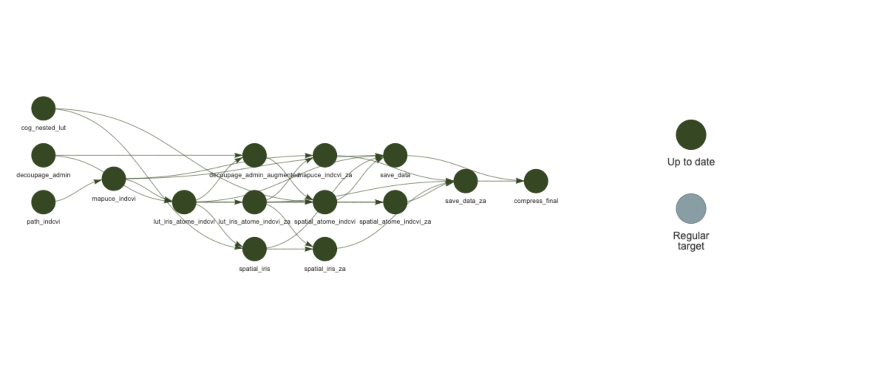
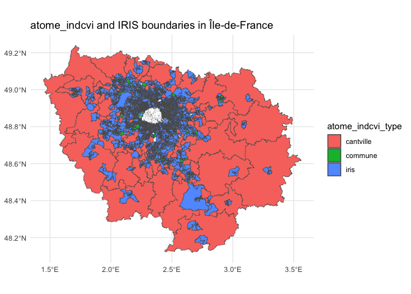
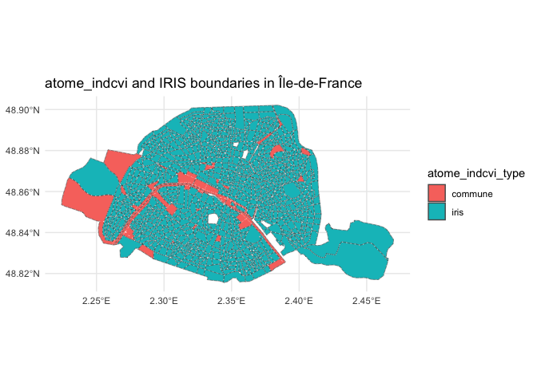

<!-- README.md is generated from README.Rmd. Please edit that file -->

# mapuce.data.2020

<!-- badges: start -->

[](https://github.com/AcidyBee/mapuce.data.2020/actions/workflows/R-CMD-check.yaml)
<!-- badges: end -->

The goal of `mapuce.data.2020` is to provide ready-to-use datasets for
MAPUCE models, derived from the 2020 French census (RP INDCVI) and the
2022 administrative boundaries.

## Installation

You can install the development version of mapuce.data.2020 like so:

``` r
remotes::install_github("AcidyBee/mapuce.data.2020")
```

## Source

Raw data come from the INSEE RP INDCVI 2020 detail files and the 2022
administrative boundaries. See `data-raw/DATASET.R` and
`data-raw/_targets.R` for the generation pipeline.

## Datasets

| Dataset | Description |
|:---|:---|
| `mapuce_indcvi` | Semantic data for France (RP 2020) |
| `mapuce_indcvi_za` | Semantic data restricted to Île-de-France |
| `lut_iris_atome_indcvi` | Lookup table between IRIS and `atome_indcvi` |
| `spatial_iris` | Spatial data at IRIS level (2022 boundaries, WGS84) |
| `spatial_atome_indcvi` | Spatial data at `atome_indcvi` level (2022 boundaries, WGS84) |
| `*_za` variants | Same datasets restricted to Île-de-France |

## Data File Naming Convention

Files follow `{dataset}_{zone}.rda` format: - `spatial_iris_za.rda`:
zone A corresponds to Île-de-France - `mapuce_indcvi.rda`: no zone
defined means the whole country

## Data Compression and Size

This package contains large datasets compressed with `xz`, except for
`mapuce_indcvi` which is compressed with `bzip2` (optimal
compression).  
- Total installed size: ~220 MB  
- Primary use: high-resolution spatial data for France, at IRIS and
`atome_indcvi` granularity  
- To reduce local disk usage, load only needed datasets with
`data("dataset_name", package = "mapuce.data.2020")`.

| Dataset                    | Size   |
|:---------------------------|:-------|
| `mapuce_indcvi`            | ~50 MB |
| `mapuce_indcvi_za`         | ~10 MB |
| `lut_iris_atome_indcvi`    | ~70 KB |
| `lut_iris_atome_indcvi_za` | ~10 KB |
| `spatial_iris`             | ~60 MB |
| `spatial_atome_indcvi`     | ~20 MB |
| `spatial_iris_za`          | ~3 MB  |
| `spatial_atome_indcvi_za`  | ~2 MB  |

## Data generation pipeline

The graph below shows the `targets` pipeline used to generate the
package datasets. Each node is a target; arrows indicate dependencies
between steps. Only the targets required to produce the final datasets
are displayed.

<figure>

<figcaption aria-hidden="true">Targets pipeline</figcaption>
</figure>

## Example

Data for this project are aggregated at what Insee calls cantville
granularity: it corresponds to: - IRIS for dense areas - COMMUNE or
CANTON for lesser population areas

The atome_indcvi key has been created to link semantic and spatial
information for Insee RP indcvi detail files. The atome_indcvi variable
is the smallest possible entity for indcvi files, and is obtained using
hierarchically (IRIS \< COMMUNE \< CANTON) the information available for
each observation in the file.

### Semantic data

Head of semantic data for zone A: Ile de France. The rows correspond to
the city of Paris.

You can see that for the 6 first rows of the dataset, the 9 digits
iris_code is available. On the other hand, for Paris the cv_code
(cantville) is not complete: it corresponds to the DEPARTEMENT
granularity. It is replaced with arm_code which only exists for the 3
major french cities: Lyon, Marseille and Paris).

``` r
data("mapuce_indcvi_za", package = "mapuce.data.2020")
head(mapuce_indcvi_za)
#> # A tibble: 6 × 17
#>   atome_indcvi atome_indcvi_type iris_code iris_type cv_code arm_code ipondi
#>   <chr>        <chr>             <chr>     <chr>     <chr>   <chr>     <dbl>
#> 1 751197309    iris              751197309 H         75ZZ    75119     3.49 
#> 2 751208014    iris              751208014 H         75ZZ    75120     1.00 
#> 3 751031104    iris              751031104 H         75ZZ    75103     1.18 
#> 4 751187027    iris              751187027 H         75ZZ    75118     0.735
#> 5 751114209    iris              751114209 H         75ZZ    75111     1.06 
#> 6 751093608    iris              751093608 H         75ZZ    75109     2.64 
#> # ℹ 10 more variables: agerev <int>, inper <int>, couple <fct>, typl_ma <fct>,
#> #   chfl_3g <fct>, cmbl_cre <fct>, surf_6g_cont <int>, surf_nbpi_4g <fct>,
#> #   nperr_123 <fct>, stocd_2g <fct>
```

### Spatial data

Corresponding choropleth map data for zone A (Ile de France)

``` r
data("spatial_iris", package = "mapuce.data.2020")
data("spatial_atome_indcvi_za", package = "mapuce.data.2020")
spatial_atome_indcvi_za %>% 
  ggplot2::ggplot(ggplot2::aes(fill = .data$atome_indcvi_type)) +
  ggplot2::geom_sf() +
  ggplot2::geom_sf(data = spatial_iris %>% dplyr::filter(stringr::str_detect(.data$iris_code, "^75")), 
                   linetype = "dotted", linewidth = .15, fill = NA, color = "white") +
  ggplot2::coord_sf() +
  ggplot2::labs(title = "atome_indcvi and IRIS boundaries in Île-de-France") +
  ggplot2::theme_minimal()
```



…and a zoom for Paris

``` r
data("spatial_iris", package = "mapuce.data.2020")
data("spatial_atome_indcvi_za", package = "mapuce.data.2020")
spatial_atome_indcvi_za %>% 
  dplyr::filter(stringr::str_detect(.data$atome_indcvi, "^75")) %>%
  ggplot2::ggplot(ggplot2::aes(fill = .data$atome_indcvi_type)) +
  ggplot2::geom_sf() +
  ggplot2::geom_sf(data = spatial_iris %>%   dplyr::filter(stringr::str_detect(.data$iris_code, "^75")), 
                   linetype = "dotted", linewidth = .15, fill = NA, color = "white") +
  ggplot2::coord_sf() +
  ggplot2::labs(title = "atome_indcvi and IRIS boundaries in Île-de-France") +
  ggplot2::theme_minimal()
```



## License

MIT. See `LICENSE.md` for details.
